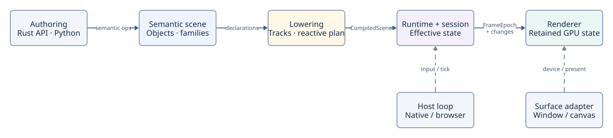
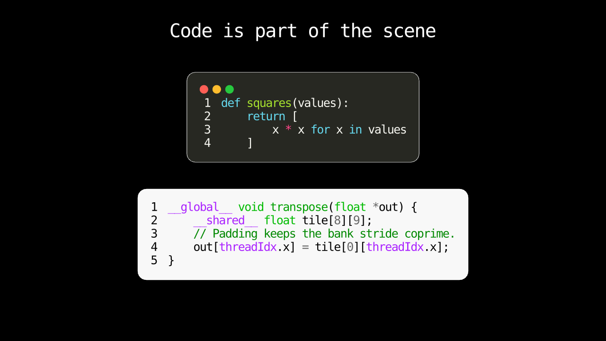

# Noon

Noon is a **Rust-native 2D animation and interactive graphics engine** with Manim-compatible Python authoring, built around a shared semantic scene, a deterministic runtime, and a retained GPU renderer.

Rust and Python expose the same observable scene semantics through shared Rust operations. Python supplies Manim-compatible syntax and arbitrary host callbacks where they are genuinely required; it does not implement a second scene, scheduler, runtime, or renderer.

The [demo gallery](https://yongkyuns.github.io/noon/) includes **Light in a
triangle**, which precomputes mirror reflections and uses ordinary shared Rust
animations to draw and move the light. Edit its triangle, launch angle and bounce
counts in Python to explore the geometry. Posters show actual Noon-rendered frames.

## Architecture

The main data path is intentionally small. Focused diagrams carry the detailed publication, locality, callback, deployment, and ownership contracts instead of crowding them into one picture.



[D2 source](docs/diagrams/overview.d2) · [Domain projections](docs/architecture.md#domain-projections) · [Revision and lifetime model](docs/architecture.md#identity-generations-revisions-versions-and-sequences) · [Locality propagation](docs/architecture.md#runtime-complexity-contract) · [Callback transaction](docs/architecture.md#ordered-transactional-host-callback-overlay) · [Current ownership](docs/architecture.md#current-implementation-ownership) · [Python worker topology](docs/architecture.md#host-language-or-multi-worker-topology).

The overview separates responsibilities rather than advertising another framework:

- **Authoring** supplies Rust/Python ergonomics and invokes shared semantic operations.
- **Semantic scene** (`SemanticStore`) owns authored identity, structure, declarations, and persistent state.
- **Lowering** (`noon-compile`) derives replaceable execution data such as slots, tracks, reactive dependencies, and resource projections.
- **Runtime/session** owns effective time-varying state, ordering, completion, wake/sleep, and coherent publication.
- **Renderer** owns retained GPU resources and dirty draw work only; native/browser hosts own platform lifecycle.

Normal native and single-context Rust/WASM engine boundaries are typed in-process Rust boundaries. Serialization is reserved for explicit codecs or genuine cross-context transport. The [architecture guide](docs/architecture.md) is the single normative source for the contracts and roadmap.

## Authoring

For supported 2D features, ordinary ManimCE source should require only the import change from `manim` to `noon`:

```python
from noon import *

class Demo(Scene):
    def construct(self):
        circle = Circle(radius=0.6, color=BLUE).shift(LEFT * 2)
        square = Square(side_length=1.2, color=PINK)
        square.next_to(circle, RIGHT)

        self.play(Create(circle), Create(square))
        self.play(
            circle.animate.shift(RIGHT * 2),
            square.animate.rotate(45 * DEGREES),
            run_time=2,
            rate_func=smooth,
        )
        self.play(Transform(circle, Square(1.4, color=PURPLE)), run_time=1.5)
        self.wait(0.5)
```

The public Rust `Scene` and `Mobject` API authors directly into the same semantic store used by the WASM handles:

```rust
use noon::Scene;

let mut scene = Scene::new();
let mut circle = scene.circle(0.6)?;
circle.shift(-2.0, 0.0)?;
circle.set_fill(0.0, 0.0, 1.0, 0.5)?;
let mut square = scene.square(1.2)?;
square.next_to_handle(&circle, 1.0, 0.0, 0.25)?;
scene.add(&circle)?;
scene.add(&square)?;
let session = scene.execution_session()?;
assert_eq!(session.frame().objects.len(), 2);
```

Constructors are scene-bound factories, `Scene::add` attaches the existing node, and handle queries return errors for stale identities. Copies allocate independent nodes in the same store. See [`shared_authoring.rs`](crates/noon/examples/shared_authoring.rs) for typed lowering and runtime execution.

### Code blocks

`Code` displays source with native syntax highlighting and preserved indentation.
Supply the source and its language; shared Rust code expands tabs at column stops,
shapes complete lines, aligns the optional line-number gutter, and sizes the
background. Scene authors do not need to color or position individual tokens.

```python
from noon import *

class CodeExample(Scene):
    def construct(self):
        listing = Code(
            code_string="def square(x):\n    return x * x",
            language="python",
            formatter_style="monokai",
            tab_width=4,
            background="window",
            paragraph_config={"font_size": 24},
        )
        self.add(listing)
```

The native Rust equivalent uses the same admission, layout and retained resources:

```rust
use noon::{Code, CodeBackground, CodeOptions, Scene};

let mut scene = Scene::new();
let listing = Code::new(&mut scene, "def square(x):\n    return x * x", CodeOptions {
    language: Some("python".into()),
    formatter_style: "monokai".into(),
    background: CodeBackground::Window,
    ..Default::default()
})?;
scene.add_many(&[listing.family().into()])?;
```

Python also accepts `code_file=...`; Rust provides `Code::from_file`. These are UTF-8
host input helpers. Explicit `language` takes precedence over filename detection.
Without a recognized filename or first-line language marker, use an explicit
language for highlighting. `Code.get_languages_list()` and
`Code.get_styles_list()` enumerate the native profile; supported themes are
`vim`, `monokai`, `friendly`, and `emacs`. Unsupported names and Python Pygments
style classes produce explicit errors.

Spaces, trailing whitespace, and all empty lines are retained. `tab_width` accepts
0 through 256; zero removes tabs. This is a source display, not a formatter or
automatic dedenter. `code_lines`, `line_numbers` when
enabled, and `background` are ordinary scene targets. In Rust, `line(index)`
returns a retained text Mobject and `line_source(index)` reads its canonical
expanded source. Family copies, transforms and animations reuse the existing
semantic engine. The `code` Cargo feature is enabled by default and depends on
native text; no Python or JavaScript process is needed by native Rust.

The current Manim-compatible constructor is implemented for this native profile;
full Pygments lexer/theme parity, arbitrary style classes, glyph-child indexing,
and the untouched upstream example's semantic/raster qualification remain owned
by [#2193](https://github.com/yongkyuns/noon/issues/2193). Leading and trailing empty
lines are deliberately preserved, including those Manim's Pygments preprocessing
may strip. See the paired [Rust](crates/noon-native/examples/code_block.rs) and
[Python](web/python/examples/code_block.py) examples.



This frame is captured from the native retained renderer by
`crates/noon/tests/code_block_raster.rs`; the paired browser checks render the
same scene through direct Rust/WASM and the production Python worker.

#### Highlight source rows

`Code` also supplies the geometry for focusing a source row or contiguous range:

```python
focus = listing.highlight_lines(0)
target = listing.get_highlighted_lines(1, 3)
self.play(Transform(focus, target))
```

Rows are zero-based, independent of the displayed line numbers. The stop index is
exclusive; omitting it selects one row. Ranges must be nonempty and within the
listing's source rows. Highlights cover the listing's full code
width, including blank, indented, whitespace-only, and final empty rows. Use
`include_line_numbers=True` to extend the band across the gutter. Shared defaults
provide a yellow fill at 0.2 opacity and 0.05 padding in the Code's local frame;
`color`, `fill_opacity`, and `padding` are optional overrides.

`highlight_lines` attaches an ordinary rectangle to `listing.highlights`, between
the opaque background and the text. `get_highlighted_lines` creates a detached
rectangle, suitable as an ordinary `Transform` target. A detached target is not
automatically added to the scene. Rust exposes the same methods with a
`Range<usize>` and `CodeHighlightOptions`, plus `_in_live_session` counterparts.

These regions describe the source rows allocated when the listing was created.
Moving an individual text row does not reflow those slots. Whole-listing
translation, rotation, reflection, representable planar scaling, and copying
preserve the frame. Live creation samples the panel's current effective pose and
priority and follows the ordinary publication gates. Replaced or baked panel
geometry, temporary effective-content replacements, and unsupported spatial or
reveal/morph overrides produce an explicit error when a new region is requested.
General reflow remains separate work tracked by
[#2302](https://github.com/yongkyuns/noon/issues/2302).

#### Reserve space for a source edit

Supply a longer source variant when creating a listing to reserve its extent
before fitting or positioning the Code. Both variants must have the same number
of rows. A later `replace_line` uses the original logical row origin and baseline,
keeping the panel, gutter, row slots and unaffected text fixed.

```python
listing = Code(
    code_string=source,
    reserved_source=padded_source,
    language="cuda",
    syntax_colors={"keyword": PURPLE, "number": GOLD},
    token_colors={"tile": TEAL, "in": TEAL, "out": GREEN,
                  "__syncthreads": PINK},
    line_number_config={"font_size": 11, "color": GRAY, "min_digits": 2},
)
self.add(listing)

previous, current = listing.replace_line(0, padded_declaration)
self.add(previous)
self.play(FadeOut(previous), Write(current), run_time=0.75)
```

The replaced row receives a fresh ordinary Text identity in `code_lines`.
`previous` leaves that listing and retains any independent memberships; adding
it explicitly allows the usual outgoing animation. `current` is already a child
of the listing. Source and token styles
are recomputed in Rust with the listing's lexical context. Unaffected rows keep
their identities and resources; a row whose syntax changes because of the edit
receives updated content through the same atomic publication. Invalid edits or
edits outside the allocated extent leave the listing unchanged. Without
`reserved_source`, the initial source defines that extent. This operation keeps a
fixed row count rather than inserting rows or reflowing the page.

Rust exposes `CodeOptions::reserved_source`, `Code::replace_line` and
`replace_line_in_live_session`. The returned `CodeLineReplacement` contains
`previous` and `current` ordinary Mobjects. The paired
[Rust](crates/noon-native/examples/code_source_update.rs) and
[Python](web/python/examples/code_source_update.py) examples animate the CUDA
declaration edit using the normal execution path.

`line_number_config` controls the gutter independently: `font_size` inherits the
source size when omitted, `color` inherits the theme's gutter color, and
`min_digits` adds leading zeroes without truncating larger numbers. A minus sign
does not count as a digit; `min_digits=2` produces `-01`, `00`, `01`. Values from
0 through 32 are supported. Rust owns formatting, shaping and measured right
alignment on the source baselines; the exact source font face is shared. The
native equivalent is `CodeOptions::line_number_config: CodeLineNumberConfig`.
Copied listings and bounded source edits retain the allocated gutter and its
ordinary Text handles.

#### Associate source tokens with visual concepts

`syntax_colors` optionally overrides `foreground`, `comment`, `keyword`,
`number`, `string` and `operator` colors from the selected theme. `foreground`
sets the unclassified fallback color; explicit theme rules retain their colors.
`token_colors`
maps exact identifiers or dotted identifier paths such as `threadIdx.x` to
colors. Matching respects Unicode identifier boundaries: `in` does not recolor
`int`, and names inside comments or strings keep their lexical colors. Exact
token matches take precedence over category colors outside comments and strings;
the longest matching dotted path wins. Rust uses `CodeSyntaxColors` and the
`CodeOptions::token_colors` map for the same behavior.

These maps express lesson-specific associations while the framework owns
lexing, context, source spans and shaping. Omitted overrides preserve the named
theme's normal presentation.

The paired [Rust](crates/noon-native/examples/code_line_highlight.rs) and
[Python](web/python/examples/code_line_highlight.py) examples highlight a blank
row and a range with line numbers after scaling and rotating the listing.

### Source-declared click indication

An authored primary click can run a restoring `Indicate` without a Python callback or per-frame Python work. The current action supports filled analytic `Circle` and `Rectangle` targets, and the `Indicate` must name the same target:

```python
self.on_click(shape, Indicate(shape, run_time=0.4))
```

The Rust equivalents publish the same semantic binding before or during live authoring:

```rust
scene.on_click_indicate(&shape, IndicateOptions::default(), AnimationOptions::new().run_time(0.4))?;
// Or, after execution starts:
live.on_click_indicate(&shape, IndicateOptions::default(), AnimationOptions::new().run_time(0.4))?;
```

The action uses restoring `there_and_back` timing. A click on an already active target is ignored. Clicks do not interrupt an active authored segment or signal/host driver. Input remains available after the introduction, including when playback is paused at its endpoint or its source program has completed; the runtime drives and settles the short effective animation without advancing authored time.

The selection gallery and native `pointer_selection` example also enable cursor-anchored inspection zoom. Scroll over the canvas to zoom, including during an indication. Rust composes a bounded session adjustment with the effective camera for both rendering and picking; authored camera values and playback remain unchanged. Native hosts opt in with `NativeViewportConfig { inspection_zoom: true, ..Default::default() }`; browser hosts use `inspectionZoom: true`. Other gallery lessons leave page scrolling available. Inspection persists across same-session seeks and playback restarts; rerunning a source or replacing its session resets inspection. Stale wheel receipts and excess in-flight worker samples are rejected rather than queued.

### Live authoring and integration boundaries

The crate root and `noon::prelude` expose ordinary authoring handles, values, live operations, completion, and typed errors. `noon::integration` is the explicit raw semantic/resource and host plumbing boundary; `noon::diagnostics` is opt-in debug/export access. Neither namespace creates another scene or runtime.

After creating an execution session, `scene.live(&mut session)` applies supported persistent edits and animation/completion operations through the same staged semantic/execution publication path. Rust `Mobject` inspection reads authored/base state; live/effective queries read the latest coherent runtime state. Failed preparation leaves both authored and effective published state unchanged.

Raw integration-store access is deliberately not a live-mutation shortcut: edits outside coherent publication can stale a session and must be handled explicitly. See [`shared_authoring.rs`](crates/noon/examples/shared_authoring.rs) for the public typed path and `docs/architecture.md` for the authored/effective and publication contracts.

### Indexed spatial meshes

The native spatial profile uses the same scene, runtime and canvas. Python exposes `SpatialScene`, `Mesh3D` and `WorldTransformTo`; Rust exposes `Scene::camera_3d`, `Scene::mesh`, `MeshOptions` and ordinary world-transform animation requests. UV callbacks run once at construction. Rust validates sampling coordinates, topology and normals, and retains the resulting immutable mesh while motion updates its instance pose.

This profile supports opaque fills without mesh strokes, quaternion rotation and one optional point light. Generated spheres, cubes, prisms, cylinders, cones and tori share the mesh lane. Cylinders and cones extend from zero to height along +Z. Surface resolution counts cells, including both endpoint rows. These explicit conventions do not claim Manim's class defaults or Cairo surface shading. Use `WorldTransformTo` for spatial animation; the planar `.animate` path is rejected for mesh objects. `SpatialScene` examples use `async construct` and `await self.play(...)` to run in browsers without JS Promise Integration.

Native mesh replacement uses ordinary atomic content publication at a valid authoring barrier. Failed replacement preserves the previous resource and pose; transforms and lights do not regenerate topology. Effective getters read published runtime state, while Rust authored getters keep the base declaration.

Equivalent examples run through the native Rust renderer and the Python browser host:

| Feature | Rust | Python |
| --- | --- | --- |
| Geometry and text | [shared_text.rs](crates/noon-native/examples/shared_text.rs) | [shared_text.py](web/python/examples/shared_text.py) |
| Live membership | [live_semantic_scene.rs](crates/noon-native/examples/live_semantic_scene.rs) | [live_semantic_scene.py](web/python/examples/live_semantic_scene.py) |
| Ordinary affine playback | [ordinary_affine_play.rs](crates/noon-native/examples/ordinary_affine_play.rs) | [ordinary_affine_play.py](web/python/examples/ordinary_affine_play.py) |
| Indexed surface motion | [spatial_surface.rs](crates/noon-native/examples/spatial_surface.rs) | [noon_spatial_surface.py](web/python/examples/noon_spatial_surface.py) |
| Composition | [ordinary_composition_play.rs](crates/noon-native/examples/ordinary_composition_play.rs) | [ordinary_composition_play.py](web/python/examples/ordinary_composition_play.py) |
| Ordered callbacks | [live_affine_callbacks.rs](crates/noon-native/examples/live_affine_callbacks.rs) | [live_affine_callbacks.py](web/python/examples/live_affine_callbacks.py) |
| Content replacement | [live_content_switch.rs](crates/noon-native/examples/live_content_switch.rs) | [live_content_switch.py](web/python/examples/live_content_switch.py) |
| Coordinate plotting | [coordinate_plotting.rs](crates/noon-native/examples/coordinate_plotting.rs) | [coordinate_plotting.py](web/python/examples/coordinate_plotting.py) |
| Retained images | [raster_image.rs](crates/noon-native/examples/raster_image.rs) | [raster_image.py](web/python/examples/raster_image.py) |
| Image glow and motion | [image_glow.rs](crates/noon-native/examples/image_glow.rs) | [image_glow.py](web/python/examples/image_glow.py) |
| Temporary glow pulses | [glow_pulse.rs](crates/noon-native/examples/glow_pulse.rs) | [glow_pulse.py](web/python/examples/glow_pulse.py) |
| Finite background music | [background_music_lesson.rs](crates/noon-native/examples/background_music_lesson.rs) | [background_music_lesson.py](web/python/examples/background_music_lesson.py) |

The complete qualification corpus lives under [`crates/noon-native/examples`](crates/noon-native/examples) and [`web/python/examples`](web/python/examples).

Run a Rust example with `cargo run -p noon-native --example live_content_switch`, or paste its paired Python source into the playground. The shared browser smoke executes the published Python files and checks their rendered output.

The broader example corpus covers callback ordering, sparse reads, family operations, composition, transforms, text, and renderer behavior. Required host callbacks hold authored progress at their ordered barrier; deterministic segments do not require per-frame Python execution when no host-dynamic work is scheduled. Unsupported compatibility behavior remains explicit rather than silently approximated.

The current plotting subset uses linear 2D coordinates and bounded sampled curves. NumberLine and Axes accept standard default ranges and two- or three-value ranges; function plots require explicit sampling ranges. NumberLine remains tipless. Function callbacks run only during bounded plot preparation; the resulting curves are ordinary retained paths. Numeric labels are constructed before playback, and a prepared plot captures its coordinate frame, so recreate it after moving its axes. Synchronized and gapped examples demonstrate bounded timestamped data rather than a streaming graph architecture.

The retained raster image example admits immutable PNG/JPEG or uint8 array resources through shared Rust semantics. The qualification corpus checks decoded dimensions, sampler behavior, opacity, endpoint transforms, and texture reuse. Noon’s decomposed Transform midpoint (22.5°/.875) differs from Manim’s pointwise quad midpoint (19.113565°/.809809), so that sample is recorded as a known boundary while endpoint parity remains explicit.

Current Phase A acceptance status is intentionally not duplicated here; use the [Phase A umbrella](https://github.com/yongkyuns/noon/issues/953) and the architecture guide for current ownership and invariants.

## Native background audio

Enable the optional `noon-native` audio feature to play finite Rust scenes through
the default output device. The example uses the same original score, motion and
three authored sections as the direct Rust/WASM background-music example:

```bash
cargo run -p noon-native --features audio --example background_audio
```

The paired Python lesson also has a native entry point. Both versions use the
same shared Rust lesson, scalar bindings, sections and music:

```bash
cargo run -p noon-native --features audio --example background_music_lesson
```

Preparation stays silent; playback starts after the first native picture is ready.
The shared Rust mixer supplies loops, trims, fades and overlapping clips on the
native player's existing timeline. The geometric example has the same five
authored buttons as its browser counterpart: Previous, Play/Pause, Next, Restart
and Sound. Both native examples also enable these keyboard controls:

| Key | Action |
| --- | --- |
| Space | Play or pause; playing a completed scene starts it again |
| Left / Right | Seek backward or forward five seconds |
| Page Up / Page Down | Previous or next authored section |
| Home | Restart at time zero |
| Up / Down | Increase or decrease viewer volume by five percentage points |
| M | Mute or restore the retained viewer volume |

Seek, section navigation and Restart preserve play/pause state. A paused seek
presents the target without starting sound. Playback waits for that picture and
the preceding release before admitting a fresh device anchor. Ordinary starts
use a 40 ms attack, pauses and seeks release over at most 60 ms, and viewer gain
changes use a 20 ms ramp. Viewer volume and mute never alter authored gains or MP4
exports. Inspection zoom leaves audio time unchanged; closing, suspension and
output failures retire device output immediately.

Library callers opt in to keyboard controls with
`NativeViewportConfig { playback_controls: true, section_navigation:
scene.section_navigation(), ..Default::default() }`. Authored scene buttons use
the shared Rust input publication and admitted session seek path. The native
control profile requires a freshly lowered finite immutable scene without prior
live execution edits, required callbacks, source continuations, retained history,
external native input routes or effective-driver leases. Deterministic scalar
bindings in the paired lesson are supported; broader live and dynamic numeric-text
profiles remain under
[#2263](https://github.com/yongkyuns/noon/issues/2263).
The current device profile admits at most 256 immutable clips and mono or stereo
output at 8–192 kHz. It requests a 20 ms callback period within the device's
supported range; the backend may negotiate a different buffer size. This keeps
the requested scheduling headroom consistent across sample rates. A device
timestamp discontinuity above 50 ms stops the run with an explicit output error.

The device backend uses ALSA on Linux, WASAPI on Windows, and CoreAudio on macOS.
Linux builds with the `audio` feature (including workspace `--all-features`
validation) require `pkg-config` and the ALSA development package, for example
`sudo apt-get install libasound2-dev pkg-config` on Debian or Ubuntu. Native audio
requires macOS 14.2 or newer with the [pinned CPAL backend](https://docs.rs/crate/cpal/0.18.2/source/README.md).
Linux ALSA routes through PulseAudio also need the upstream
[startup timing fix](https://github.com/alsa-project/alsa-plugins/commit/811c2ce69d1265ace42a05ef045ca1b4ed72e01c).
Older Pulse plugins can report missing initial timing as an I/O error; Noon stops
playback when the backend reports that failure. The software-device CI fixture
selects a private build containing the fix without replacing system plugins.
The feature is disabled by default, so visual-only native builds do not acquire
this audio dependency.
Automated output and clock checks do not establish physical-speaker latency or
replace listening tests on supported devices.
Linux capture fixtures use a private PulseAudio sink and a 60 Hz software viewport
to check recorded PCM, output ramps, silent gaps and exact source offsets. This
controlled software profile does not establish resilience under arbitrary host
load. Captured gaps and driver-reported underruns, including a headless attempt,
remain recorded in [#2263](https://github.com/yongkyuns/noon/issues/2263); their
underlying cause and broader load/device qualification remain open.

## Browser playground

The [background-music lesson](web/python/examples/background_music_lesson.py)
authors a complete 30-second Python scene with native scalar motion, three
sections and the original score *A Small Discovery*. The gallery's **Play with
sound**, seek, section, volume and mute controls use shared Rust timing. The
same source can be exported with H.264 video and AAC audio through the existing
native MP4 sink; see [audio playback and export](web/README.md#background-audio-and-scene-navigation)
for the finite authoring profile and command.

The browser demo combines:

- Rust/WASM scene compilation and evaluation;
- WebGPU rendering with automatic WebGL2 fallback;
- a Pyodide worker for interactive Python authoring;
- shared Rust live mutations and source-session replacement on rerun;
- runtime and GPU profiling counters.

The current semantic Python path keeps the shared Rust/WASM semantic context **and its execution session in the authoring worker** beside Pyodide. Python calls shared operations synchronously through handles; the semantic engine endpoint leases the existing player in that same context. A separate render owner receives derived resource bundles and execution deltas over the actual worker boundary, using transferable buffers or a shared mailbox. Rendering can fall back to the main thread without moving semantic/runtime authority. Deterministic playback without host callbacks does not require per-frame Python interpreter execution. See the [current worker diagram](docs/architecture.md#host-language-or-multi-worker-topology).

Build the current demo from the repository root:

```bash
bash scripts/build-web-demo.sh
python3 -m http.server --directory web 8080
```

Then open `http://localhost:8080`.

Every scene exposed by the playground picker is authored through the shared Rust semantic operations and executed by the common runtime in CI before deployment.

## Workspace

The active implementation lives under `crates/`. Current responsibilities are:

- `noon` — public Rust API, shared authoring operations, and execution-session orchestration;
- `noon-core` — shared semantic identity/store, declarations, resources, and renderer-independent data contracts;
- `noon-compile` — semantic analysis, specialization, lowering, `CompiledScene`, root-order publication preparation, and geometry preparation;
- `noon-runtime` — deterministic mutable execution, reactive evaluation, scheduling, and incremental updates;
- `noon-render-wgpu` — retained WebGPU renderer;
- `noon-native` — native window/event-loop/surface integration, isolated by its platform dependencies;
- `noon-web` — WASM/browser integration;
- supporting geometry/text crates only where a real dependency or compilation boundary justifies them.

`noon-ir`, migration scene/document models, and obsolete browser execution mirrors have been deleted. Module/crate normalization is complete: `SemanticStore` remains in `noon-core`, `CompiledScene` in `noon-compile`, effective execution in `noon-runtime`, and session orchestration in `noon`. Serialization remains only for explicit codecs and genuine cross-context transport.

The [current ownership diagram](docs/architecture.md#current-implementation-ownership) shows these settled responsibility boundaries. Remaining finite Phase A acceptance work is tracked from [#953](https://github.com/yongkyuns/noon/issues/953), rather than by reopening completed migration/module-normalization tracks. Diagram sources and checked-in SVGs are refreshed with `python3 scripts/architecture_diagrams.py`; CI checks that they agree.

Crates should correspond to real dependency or compilation boundaries. Prefer modules over crates until an independent build/dependency/reuse boundary exists.

## Development

The required CI gate runs:

```bash
cargo fmt --all -- --check
cargo check --workspace --all-targets --all-features
cargo clippy --workspace --all-targets --all-features -- -D warnings
cargo test --workspace --all-features
bash scripts/build-web-demo.sh
```

It also checks geometry correctness, browser-target compilation, Python playground execution, Manim compatibility smoke scenes, and native compilation of picker scenes.

The architecture roadmap requires additional validation around single-authority semantics, mutation atomicity, reactive dirty propagation, cross-language semantic parity, host callback batching, and mixed static/dynamic performance.

## Design priorities

In order:

1. one authoritative Semantic Scene and one typed lowering/publication boundary;
2. first-class Rust authoring and execution on native and direct Rust/WASM targets;
3. Manim-compatible Python ergonomics over the same shared semantics;
4. unrestricted interactivity and mutability without imposing dynamic overhead on static content;
5. deterministic correctness, direct-seek semantics, and coherent authored/effective state;
6. automatic specialization and strict locality through validation, execution, rendering, and GPU publication;
7. explicit, measured deviations only where exact Manim behavior has a fundamental design or performance blocker.

Compatibility is an API/semantic goal, not an implementation constraint: Noon does not copy Manim's renderer, internal point-cloud representation, Python-side scene engine, or Python-per-frame execution model.

## Optional Rust text providers

The `noon` crate keeps native text, Typst layout and bundled fonts enabled by
convenience defaults. Geometry-only consumers can opt out explicitly:

```toml
[dependencies]
noon = { path = "path/to/noon/crates/noon", default-features = false }
```

`native-text` enables `Text`, `Scene::text`, `Mobject::from_text` and live text
construction. `typst` enables `Typst`/`MathTypst` and their corresponding
constructors. `bundled-fonts` supplies the existing font assets, but does not
activate either compiler by itself. Native shaping with supplied fonts needs
only `features = ["native-text"]`; Typst with supplied fonts needs only
`features = ["typst"]`. Add `bundled-fonts` for family-based convenience lookup.
Typst still requires its upstream base assets (including PDF standard-font data);
disabling bundles excludes its optional typography font families, not those base
compiler resources. Geometry-only and native-text-only builds exclude Typst's
assets package entirely.

Supply native font bytes via `NativeFontFace::new(family, bytes, face_index)` and
`Text::with_font_face(face)`. Supply Typst font buffers via
`Typst::with_fonts` or `MathTypst::with_fonts` (an iterator of `Arc<[u8]>`). The
`noon-typst` backend also exposes `compile_typst_resource_with_fonts` for direct
resource integrations. These inputs normalize into the existing shared resource
store; they do not introduce another registry or execution path. Selecting a
native family with `with_font` clears an earlier explicit face. An empty or
invalid explicit Typst font set is an error even when bundled fonts are enabled.

`bundled_native_font_face(family)` resolves the same embedded regular face into a
reusable Rust input. Python exposes `NativeFontFace(family, bytes, face_index=0)`
and `NativeFontFace.bundled(family)`, accepted by `Text` and `MarkupText` through
`font=face`. Reusing a face shares its immutable Rust bytes and content identity.
`Text.set_default(font=face)` changes only future Python constructors that omit
`font`; `Text.set_default()` restores the portable DejaVu Sans Mono default.
MarkupText has its own constructor default. These APIs do not discover OS fonts.
Markup styles require a matching embedded styled face; unavailable styles reject.

An explicit face can select `NativeFontMetricsProfile::CairoCoreText` with
`with_metrics_profile(...)`; Python uses
`face.with_metrics_profile("cairo-coretext")`. This opts into fractional Pango
placement and the Cairo/CoreText outline recipe for static monochrome TrueType
faces. CFF, variable and intrinsic color fonts are rejected for this profile.
The default `CairoFreeType` / `"cairo-freetype"` recipe remains portable across
hosts. Font bytes, resources, vector reveal paths and glyph masks stay in the
shared Rust pipeline; this is a Noon font configuration API.

Without bundles, family lookup fails with `TextAuthoringError::FontUnavailable`
and the Typst convenience constructors report `TypstBackendError::FontsUnavailable`.
There is no provider substitution. Provider-specific APIs are absent when their
feature is disabled; bundled-font reference scenes additionally require the
asset feature. Shared semantic text/resource types, lowering and runtime support
remain available independently of those concrete compilers.

Cargo features are additive: another dependency enabling `noon` defaults can
re-enable providers. The [external consumer and qualification commands](fixtures/provider-consumer/README.md)
inspect the resolved active graph independently of Noon's workspace and record
native/WASM build and footprint evidence.
